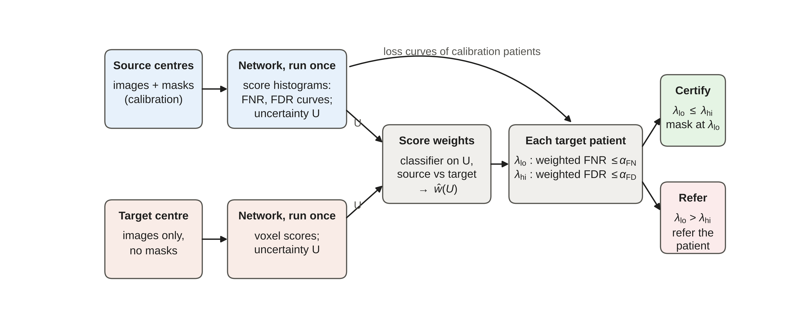

# Trust or Refer (certify-or-abstain)

Code for **"Trust or Refer: Label-Free Risk Control for 3D MRI Segmentation at New Hospitals"**
(Kazi Tani L. F., Kazi Tani M. Y., Hamza Cherif S., submitted to the *Journal of Medical and Biological Engineering*).

At an unseen hospital, a segmentation model may fail without warning, and standard conformal risk control (CRC)
can silently exceed its target. This repository implements a **score-weighted, two-sided certify-or-abstain rule**:
for each patient of a new centre it either returns a 3D mask whose false-negative rate (FNR) and false-discovery
rate (FDR) are bounded, or refers the patient. It needs no label from the new centre, only its images.



## Repository layout

```
src/scrc/        conformal layer (CPU only: numpy, scikit-learn), unit-tested
  summary.py       3D probabilities -> per-patient summary (score histograms, volumes, uncertainty)
  losses.py        exact FNR / FDR / Dice / volume curves at every threshold, from the histograms
  crc.py           standard and weighted CRC, effective sample size
  weights.py       cross-fitted density-ratio weights (logistic domain classifier)
  twosided.py      two-sided certify-or-abstain (FNR lower threshold, FDR envelope upper threshold)
  selective.py     joint risk with abstention, Learn-then-Test
  volume.py        conformal volume / ejection-fraction intervals
src/seg/         residual 3D U-Net, sliding-window inference, MC-dropout, augmentation (pure PyTorch)
scripts/
  preprocess_prostate.py, preprocess_mnms.py   NIfTI -> .npz volumes
  diagnose_mnms.py                             reports why an M&Ms subject is not preprocessed
  train_seg.py, infer_summaries.py             one leave-one-centre-out fold (GPU)
  run_v2.py          two-sided analysis, hybrid with k labeled target patients
  run_baselines.py   standard CRC, shift detector + refusal, uncertainty gate, ours (bootstrap CIs)
  run_revision.py    risk among certified, one-sided bounds, sample-split weights, assumption check
  run_matched.py     equal-coverage comparison with the uncertainty gate, risk-coverage curves
  run_revision2.py   cross-fitted vs sample-split weights over repetitions, validation-set size, uniform shift check
  run_revision3.py   TV estimate, score-volume correlation, regularisation C, inductive use, sample sizes
  exp_misweight.py   synthetic study of mis-estimated weights and assumption violations
  exp_gate_synth.py  synthetic comparison with the uncertainty gate
  run_bootstrap.py, run_ef.py, run_conformal.py, exp_synthetic.py
  fig_jmbe.py, fig_schema.py                   figures of the paper
notebooks/       Kaggle notebooks (GPU T4) for prostate and M&Ms; *_seeds.ipynb retrain with other seeds
tests/           unit tests and a GPU-free end-to-end pipeline on fake volumes
data/prostate_summaries/   per-patient summaries of the prostate folds (no image, no mask)
results/         tables behind the paper and its Online Resources (see below)
figures/         Fig. 1-3 of the paper
```

The GPU is used once per fold. Each patient is then summarised by voxel-score histograms, from which the FNR, FDR,
Dice and volume are recomputed exactly at every threshold, so all conformal analyses run on a CPU in seconds.

## Quick start (CPU)

```bash
pip install -r requirements.txt
PYTHONPATH=src pytest -q tests                      # 12 tests
# reproduce the prostate rows of Tables 2 and 4 from the released summaries
python scripts/run_baselines.py --runs "data/prostate_summaries/strong/*" --B 1000 --out check_prostate.csv
# risk among certified patients, one-sided bounds, sample-split weights, assumption check (prostate)
python scripts/run_revision.py --runs "data/prostate_summaries/strong/*" --tag P --out check_revision
# synthetic study of mis-estimated weights (Online Resource 2, S6)
python scripts/exp_misweight.py --reps 400 --out check_misweight
```

## Where each result comes from

All main results use leave-one-out cross-fitted weights (`scrc.weights.loo_weights`, deterministic) and
1000 bootstrap resamples; everything is in `results/v5/`.

| Result in the paper | File in `results/v5/` | Script |
| --- | --- | --- |
| Table 2, Fig. 2 (prostate) | `rev_P.csv`, `rev_Pbase.csv` (`fig_P.csv`, `fig_Pbase.csv`: same rows, figure format) | `run_revision.py`, `fig_jmbe.py` |
| Table 3, Fig. 3 (cardiac) | `rev_ED.csv`, `rev_ES.csv` (`fig_ED.csv`, `fig_ES.csv`) | `run_revision.py`, `fig_jmbe.py` |
| Table 4 (abstention rules) | `rev_*.csv` (standard, ours, sample-split, gates), `bl_*.csv` (shift detector) | `run_revision.py`, `run_baselines.py` |
| Table 5 (leave-one-out, 5-fold, sample-split) | `split.csv` | `run_revision2.py --what split` |
| Section 3.4; Online Resource 2 S2, S3, S8 | `rev_*.csv`, `rev3.csv`, `ncal.csv`, `csel.csv` | `run_revision.py`, `run_revision3.py`, `run_revision2.py --what ncal`, `run_csel.py` |
| Referral decomposition, label-free $C$ (Table S8) | `decompose.csv`, `csel.csv` | `run_decompose.py`, `run_csel.py` |
| Equal-coverage comparison, Fig. S1 | `matched_boot.csv`, `gate_curve_pooled.csv`, `sweep_*.csv` | `run_matched.py`, `run_revision.py` |
| Ejection fraction, Table S3 | `ef/ef_intervals.csv` | `run_ef.py` |
| Simulations, Tables S4 and S5 | `misweight/misweight.csv`, `gate_synth/gate_synth.csv` | `exp_misweight.py`, `exp_gate_synth.py` |

All files hold per-centre or pooled statistics only.

`scripts/check_independent.py` re-implements standard CRC and the leave-one-out rule from their definitions
(scikit-learn only) and reproduces `rev_*.csv` to within 1e-4 in all 16 settings.

## Data

| Dataset | Access | Redistributed here |
| --- | --- | --- |
| Multi-site prostate MRI (6 centres; Liu et al., MICCAI 2020) | public download from the authors' repository | per-patient summaries only |
| M&Ms cine cardiac MRI (5 centres, 4 vendors; Campello et al., IEEE TMI 2021) | on request from the challenge organisers, under a research-use agreement | **nothing** |

M&Ms images, masks and any data derived from them per patient are **not** in this repository, in line with the
data-use agreement. To reproduce the cardiac results, obtain the data from the organisers, then:

```bash
python scripts/preprocess_mnms.py --raw MnMs --out mnms_npz --label lv     # 306 patients, 612 volumes
python scripts/diagnose_mnms.py MnMs mnms_npz      # lists the 8 subjects whose image file is missing
# train and infer the 5 folds with notebooks/kaggle_mnms.ipynb (GPU), then:
python scripts/run_baselines.py --runs "runs_mnms/*" --phase ED --B 1000 --out results/v5/bl_ED.csv
python scripts/run_baselines.py --runs "runs_mnms/*" --phase ES --alpha_fnr 0.25 --alpha_fdr 0.35 --B 1000 --out results/v5/bl_ES.csv
python scripts/run_revision.py --runs "runs_mnms/*" --phase ED --tag ED --B 1000 --out results/v5
python scripts/run_revision.py --runs "runs_mnms/*" --phase ES --alpha_fnr 0.25 --alpha_fdr 0.35 --tag ES --B 1000 --out results/v5
python scripts/run_ef.py --runs "runs_mnms/*" --out results/v5/ef
python scripts/run_matched.py --prostate data/prostate_summaries/strong --mnms runs_mnms --out results/v5
python scripts/run_revision2.py --what split --mnms runs_mnms --out results/v5
python scripts/run_revision2.py --what ncal --mnms runs_mnms --out results/v5
python scripts/run_revision3.py --mnms runs_mnms --out results/v5
python scripts/run_csel.py --mnms runs_mnms --out results/v5
python scripts/run_decompose.py --mnms runs_mnms --out results/v5
```

## Citation

If you use this code, please cite the paper (reference to be completed on publication) and the archived release
(DOI on Zenodo, see `CITATION.cff`).

## Licence

MIT (see `LICENSE`). The datasets keep their own licences and terms of use.
